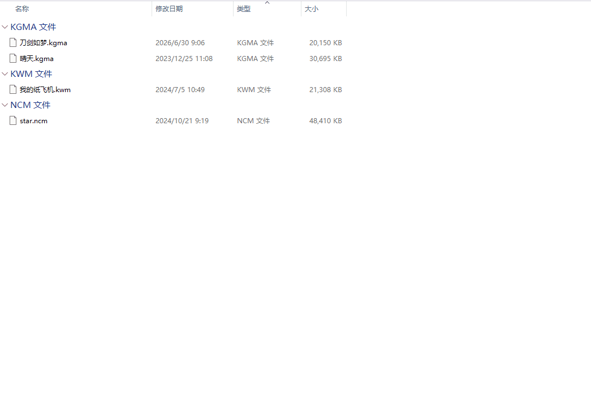

# 加密音乐解锁

> 在本地把网易云（.ncm）、QQ 音乐（.mflac/.mgg/.tkm）、酷狗（.kgm/.kgma/.vpr）、酷我（.kwm）的加密音乐一键解密成标准 mp3/flac，还原歌名、歌手、专辑和封面。文件全程不出电脑，自动识别格式、支持批量。

---

## 核心特性

- **四平台全支持**：网易云、QQ 音乐、酷狗、酷我，按魔数 + 扩展名自动识别，无需手动指定格式
- **一键批量解锁**：可拖入单个文件或整个文件夹，目录自动递归扫描，命名冲突自动加 `(1)` 后缀
- **支持右键启动:**   鼠标选中需解锁音乐文件、在右键菜单选中**加密音乐解锁**、即可启动脚本进行解锁 
- **标签封面还原**：歌名、歌手、专辑、封面图自动写回输出文件（可关闭）
- **纯本地处理**：解密全程在本机完成，文件不上传任何服务器
- **图形化启动窗口**：运行前弹出窗口，勾选输出目录、是否嵌入标签、是否强制覆盖等选项
- **鸣谢:**  脚本核心代码来自开源项目[music-geshizhuanhuan](https://github.com/Afle520/music-geshizhuanhuan)

---

## 脚本演示

---

## 安装方法

本脚本的运行环境、依赖组件及图形化窗口均依赖"不忙脚本盒子"，建议仅通过盒子安装和使用本脚本。

> 前置条件：安装好 [不忙脚本盒子](https://www.bm-box.cn)

* 打开盒子 → **脚本市场** → 搜索 **「加密音乐解锁」**
* 点击「安装」

---

## 使用方式

* **直接启动**
  * 在盒子里点击脚本卡片，弹出启动窗口
  * 在「加密音乐」区点击选择，可多选文件或选中整个文件夹
  * 按需调整「输出目录」「嵌入标签封面」等选项，点击「执行」
* **右键启动**
  * 在文件管理器中选中加密音乐文件（或文件夹），右键 → **加密音乐解锁**
  * 盒子弹出启动窗口，确认后点击「执行」

解锁完成后，在「输出目录」中找到标准格式音频；输出目录留空时，解锁结果直接输出到原文件所在目录。

---

## 💡 使用提示

| 参数         | 说明                                        |
| ---------- | ----------------------------------------- |
| **输出目录**   | 解密结果保存位置；**留空则输出到原文件所在目录**                |
| **嵌入标签封面** | 勾选后把歌名/歌手/专辑/封面写回文件；关闭则只解密不写元数据           |
| **递归扫描**   | 目录输入时是否扫描所有子目录                            |
| **强制覆盖**   | 输出文件已存在时直接覆盖；关闭则自动加 `(1)` 后缀              |
| **仅预览**    | 只列出将要处理的文件，不实际写入                          |
| **高级模式**   | 用于新版 QQ 音乐（无内嵌密钥）指定 EKey / 安卓密钥库，或酷狗自定义公钥 |

> 新版 QQ 音乐（PC 客户端 19.57+）下载的文件不再内嵌密钥，需在**高级模式**下提供 EKey 或安卓端 `player_process_db` 密钥库；或把客户端降到 19.51 及以下重新下载。

---

## 🖥️ 环境要求

| 项目       | 要求                      |
| -------- | ----------------------- |
| **操作系统** | Windows 10+（64 位）       |
| **运行环境** | Python 3.10+（由盒子自动安装依赖） |

## 📄 合规声明

本脚本仅用于解密**自己合法下载、有权使用**的本地文件，仅供个人学习研究。请勿批量分发、倒卖或规避付费授权。

